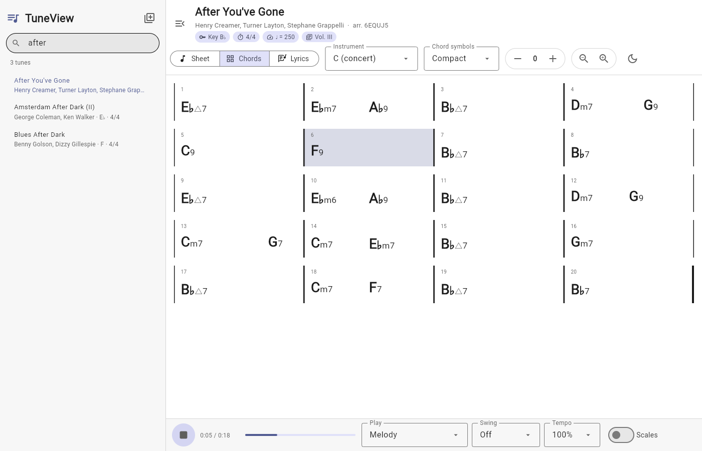
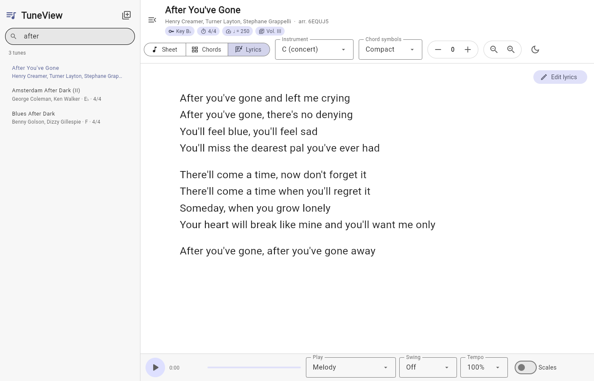
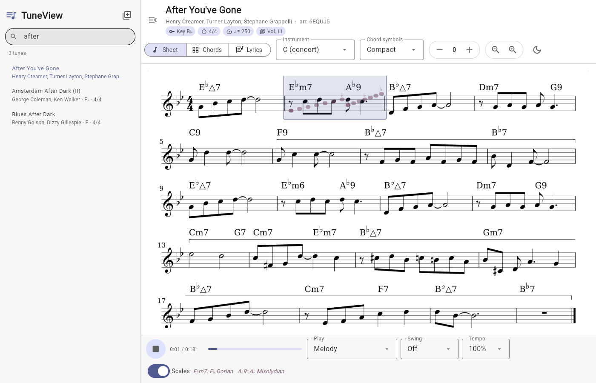

# TuneView

A leadsheet viewer for the music stand. Pick a tune and TuneView shows it the
way you need to play it:




- **Sheet**: the engraved leadsheet, with melody, chord symbols and lyrics (when
  the source has them), repeats, endings and D.S./coda marks.
- **Chords**: a large-print chord chart, four bars per line, with chords placed
  on their beats. When the tune has lyrics, the words are printed under the
  chords too; **Align lyrics** opens an editor where you move words from bar to
  bar, and the layout is saved with the tune. There, `Enter` splits a bar at the
  cursor and pushes the later bars forward (at the bar's start it leaves an empty
  bar); `Backspace`/`Delete` at a bar's start/end join it with the neighbouring
  bar and pull the later bars back. It's easy to read from a distance.
- **Lyrics**: the words in large print. Add or edit them with the Lyrics
  view's button: paste or type them, with a blank line between verses; a line
  like `[Chorus]` or `Verse 2:` on top of a verse becomes its heading.

  

- **Transposition** for B♭, E♭ and F instruments, plus any extra shift in
  semitones. The notation, the chord chart and the displayed key all follow it.
- **Chord symbols**: Compact (the default) spells them the jazz way: `Cm7`,
  `C△7`, `Cø7`, `C°7`. As written uses the labels from the source file instead
  (`Cmin7`, `Cmaj7`…).
- **Playback**: the melody, a simple band (bass and piano comping from the chord
  symbols) or both. It plays at concert pitch plus your own transposition, at
  50–150% of the written tempo. Swing is optional: Off (the default), Light,
  Medium, Hard, or Auto, which guesses per tune. The bar being played is
  highlighted and kept in view in both the Sheet and Chords views.
- **Scales for improvising**: turn on Scales (or press `G`) and, while the tune
  plays, the bar being played shows a scale for each chord as faint noteheads on
  the staff, climbing from the chord symbol, with the scale names in the
  transport bar. The choice follows chord-scale practice (m7 → Dorian, 7 →
  Mixolydian, ø7 → Locrian, °7 → whole-half diminished, 7♭9 → half-whole…),
  refined by the key (a m7 on the 3rd of the key is Phrygian, a △7 on the 4th is
  Lydian) and by where a dominant resolves (into a minor chord → Phrygian
  dominant). Accidentals outside the key signature are printed above their
  notes.

  

- Instant search across title and composer, light and dark themes, and keyboard
  control that works with page-turner pedals.

Built with [Flet](https://flet.dev) 1.x, with [Verovio](https://www.verovio.org)
for engraving.

## Setup

Dependencies are managed with [uv](https://docs.astral.sh/uv/):

```bash
uv sync
```

### Build the library

TuneView keeps MusicXML leadsheets (`.musicxml`, `.xml` or compressed `.mxl`)
in a single SQLite file, `leadsheets.sqlite` at the project root (override with
`TUNEVIEW_DB`). It's created empty the first time you run TuneView.

Add music from the app with the add button above the library: pick files, or
(on the desktop) a whole folder. Or import a folder from the command line:

```bash
uv run tuneview-import /path/to/musicxml    # searched recursively
```

Identical files are added once, so adding a folder again only picks up new
files. When adding a folder, each sub-folder name becomes the tune's volume
(e.g. `I`, `II`).

Lyrics you add in TuneView are saved in the same file, so back it up rather
than deleting it to rebuild: adding music again keeps them.

## Run

```bash
uv run tuneview                   # desktop window
TUNEVIEW_WEB=1 uv run tuneview    # in the browser instead
uv run pytest                     # tests
```

In the browser, TuneView prints the address to open on this computer and, when
the machine is on a network, the address to use from another computer on the
local network (the web server listens on all interfaces). Set `TUNEVIEW_PORT`
to choose the port if you need a fixed one.

Playback in the browser is played by the browser that opened the tune, so every
computer hears it through its own speakers and the machine running TuneView
stays silent.

## Keyboard

| Key | Action |
| --- | --- |
| `/` | search (`Enter` opens the best match, `Esc` clears) |
| `P` | play / stop |
| `Space` | pause / resume while playing (scrolls otherwise) |
| `G` | show / hide the improvisation scales |
| `↓` `↑`, `PgDn` `PgUp`, `Space` | scroll (page-turner pedals send these; Space only when not playing) |
| `Home` | back to the top |
| `]` `[` | transpose up / down a semitone |
| `+` `-` | larger / smaller notation |
| `S` / `C` / `W` | sheet / chord chart / lyrics |
| `L` | show / hide the library |
| `D` | dark / light |
| `F11` | full screen (desktop) |
