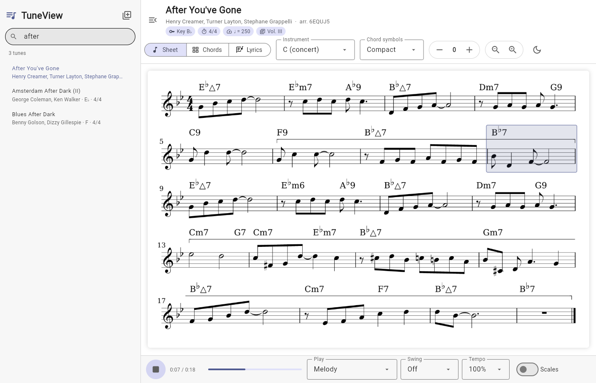

# TuneView

A leadsheet viewer for the music stand. Pick a tune and TuneView shows it the
way you need to play it:




- **Sheet**: the engraved leadsheet, with melody, chord symbols and lyrics (when
  the source has them), repeats, endings and D.S./coda marks.
- **Chords**: a large-print chord chart, four bars per line, with chords placed
  on their beats. When the tune has lyrics, the words are printed under the
  chords too; **Align lyrics** opens an editor where you move words from bar to
  bar, and the layout is saved with the tune. There, `Enter` splits a bar at the
  cursor and pushes the later bars forward (at the bar's start it leaves an empty
  bar); `Backspace`/`Delete` at a bar's start/end join it with the neighbouring
  bar and pull the later bars back. It's easy to read from a distance.
- **Lyrics**: the words in large print. Lyrics already written under the melody
  in an imported score are extracted automatically, keeping the bars they belong
  to so the chord chart starts out aligned (the first verse when the score has
  several); otherwise add or edit them with the Lyrics view's button:
  paste or type them, with a blank line between verses; a line like `[Chorus]`
  or `Verse 2:` on top of a verse becomes its heading.

  

- **Transposition** for B♭, E♭ and F instruments, plus any extra shift in
  semitones. The notation, the chord chart and the displayed key all follow it.
- **Chord symbols**: Compact (the default) spells them the jazz way: `Cm7`,
  `C△7`, `Cø7`, `C°7`. As written uses the labels from the source file instead
  (`Cmin7`, `Cmaj7`…).
- **Playback**: the melody, a simple band (bass and piano comping from the chord
  symbols) or both. It plays at concert pitch plus your own transposition, at
  50–150% of the written tempo. Swing is optional: Off (the default), Light,
  Medium, Hard, or Auto, which guesses per tune. The bar being played is
  highlighted and kept in view in both the Sheet and Chords views.
- **Scales for improvising**: turn on Scales (or press `G`) and, while the tune
  plays, the bar being played shows a scale for each chord as faint noteheads on
  the staff, climbing from the chord symbol, with the scale names in the
  transport bar. The choice follows chord-scale practice (m7 → Dorian, 7 →
  Mixolydian, ø7 → Locrian, °7 → whole-half diminished, 7♭9 → half-whole…),
  refined by the key (a m7 on the 3rd of the key is Phrygian, a △7 on the 4th is
  Lydian) and by where a dominant resolves (into a minor chord → Phrygian
  dominant). Accidentals outside the key signature are printed above their
  notes.

  

- Instant search across title, composer and source file name, light and dark themes, and keyboard
  control that works with page-turner pedals.

Built with [Flet](https://flet.dev) 1.x, with [Verovio](https://www.verovio.org)
for engraving.

The app icon uses the **music_note** glyph from
[Google Material Icons](https://github.com/google/material-design-icons),
licensed under the Apache License 2.0 (see `src/tuneview/assets/icons/`); that
attribution applies to the icon files only.

## Install

Once published to PyPI, install TuneView as an isolated command with
[`uv tool install`](https://docs.astral.sh/uv/guides/tools/):

```bash
uv tool install tuneview
```

That puts `tuneview` and `tuneview-import` on your `PATH`. From a checkout or a
git URL instead:

```bash
uv tool install --editable .                                  # this checkout
uv tool install "git+https://github.com/fccoelho/tuneview"    # from GitHub
```

Run `tuneview` for the desktop window, or `TUNEVIEW_WEB=1 tuneview` in the
browser.

## Setup

Dependencies are managed with [uv](https://docs.astral.sh/uv/):

```bash
uv sync
```

### Build the library

TuneView keeps leadsheets in a single SQLite file: `leadsheets.sqlite` in the
project root when run from a checkout, or in your platform's data directory
when installed (for example `~/.local/share/tuneview/leadsheets.sqlite` on
Linux). Override it with `TUNEVIEW_DB`. It accepts MusicXML (`.musicxml`,
`.xml` or compressed `.mxl`) and MuseScore 3/4 scores (`.mscz`/`.mscx`,
converted to MusicXML on import). It's created empty the first time you run
TuneView.

Add music from the app with the add button above the library: pick files, or
(on the desktop) a whole folder. Or import a folder from the command line:

```bash
uv run tuneview-import /path/to/scores    # searched recursively
```

Identical files are added once, so adding a folder again only picks up new
files. When adding a folder, each sub-folder name becomes the tune's volume
(e.g. `I`, `II`).

Lyrics you add in TuneView are saved in the same file, so back it up rather
than deleting it to rebuild: adding music again keeps them.

## Run

```bash
uv run tuneview                   # desktop window
TUNEVIEW_WEB=1 uv run tuneview    # in the browser instead
uv run pytest                     # tests
```

In the browser, TuneView prints the address to open on this computer and, when
the machine is on a network, the address to use from another computer on the
local network (the web server listens on all interfaces). Set `TUNEVIEW_PORT`
to choose the port if you need a fixed one.

Playback in the browser is played by the browser that opened the tune, so every
computer hears it through its own speakers and the machine running TuneView
stays silent.

## Publishing

Publishing a GitHub release runs `.github/workflows/publish.yml`: it runs the
test suite, checks that the release tag matches the version in `pyproject.toml`
(`v1.2.3` ↔ `1.2.3`), builds the sdist and wheel, and uploads them to PyPI.
Releases use PyPI Trusted Publishing (OIDC), so no API token is stored in the
repository.

Before the first release, add a Trusted Publisher for the `tuneview` project on
PyPI with:

- owner: `fccoelho`
- repository: `tuneview`
- workflow: `publish.yml`
- environment: `pypi`

The workflow can also be started manually from the Actions tab
(`workflow_dispatch`).

## Keyboard

| Key | Action |
| --- | --- |
| `/` | search (`Enter` opens the best match, `Esc` clears) |
| `P` | play / stop |
| `Space` | pause / resume while playing (scrolls otherwise) |
| `G` | show / hide the improvisation scales |
| `↓` `↑`, `PgDn` `PgUp`, `Space` | scroll (page-turner pedals send these; Space only when not playing) |
| `Home` | back to the top |
| `]` `[` | transpose up / down a semitone |
| `+` `-` | larger / smaller notation |
| `S` / `C` / `W` | sheet / chord chart / lyrics |
| `L` | show / hide the library |
| `D` | dark / light |
| `F11` | full screen (desktop) |


## License

Copyright (C) 2022–2026 Flávio Codeço Coelho.

TuneView is free software: you can redistribute it and/or modify it under the
terms of the GNU General Public License as published by the Free Software
Foundation, version 3.

TuneView is distributed in the hope that it will be useful, but WITHOUT ANY
WARRANTY; without even the implied warranty of MERCHANTABILITY or FITNESS FOR A
PARTICULAR PURPOSE. See the GNU General Public License for more details.

You should have received a copy of the GNU General Public License along with
TuneView; see [LICENSE](LICENSE). If not, see
<https://www.gnu.org/licenses/gpl-3.0.html>.
